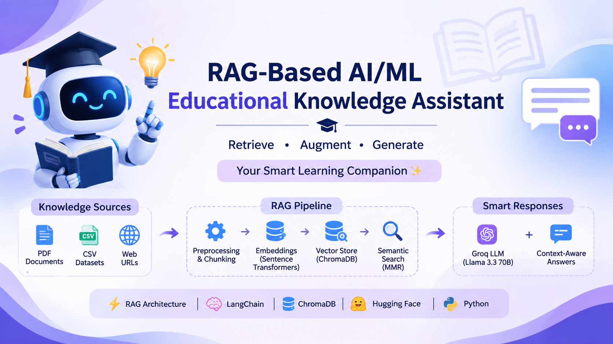

<p align="center">
  
</p>

# RAG-Based AI/ML Educational Knowledge Assistant

An intelligent educational knowledge assistant built using **Retrieval-Augmented Generation (RAG)**, LangChain, ChromaDB, Hugging Face embeddings, and Groq LLMs. The system retrieves relevant information from multiple knowledge sources and generates context-aware answers to AI/ML-related questions.

## 🏢 Project Context

This project was independently designed and developed as a **client project during my AI Internship at Rubixe (May–October 2026)**.

I independently handled the complete project implementation, from organizing knowledge sources to building the Retrieval-Augmented Generation pipeline and integrating the language model.

The project provided practical experience in developing a Generative AI solution for a client-oriented requirement.

## 📌 Project Overview

Finding accurate and relevant information across multiple educational resources can be time-consuming. Traditional keyword-based search systems may not understand the meaning or context behind a question.

This project addresses that challenge by implementing a RAG-based knowledge assistant that retrieves relevant information from PDF documents, CSV files, and web URLs before generating responses using a Large Language Model (LLM).

The system combines document retrieval with LLM-based generation to provide responses grounded in the retrieved knowledge.

## 🎯 Project Objectives

- Develop an AI-powered educational knowledge assistant.
- Integrate multiple knowledge sources, including PDF, CSV, and web URLs.
- Extract, preprocess, and organize document content.
- Generate semantic embeddings using transformer-based models.
- Store document embeddings in a vector database.
- Retrieve relevant information using semantic search.
- Generate context-aware answers using an LLM.
- Explore evaluation techniques for retrieval and response quality.

## ✨ Key Features

- **Multi-source Document Ingestion:** Supports PDF documents, CSV files, and web URLs.
- **Text Preprocessing:** Extracts and prepares content for retrieval.
- **Document Chunking:** Splits documents into smaller text segments.
- **Transformer-based Embeddings:** Converts text into numerical vector representations.
- **Vector Database:** Uses ChromaDB for storing and retrieving embeddings.
- **Semantic Retrieval:** Retrieves relevant content based on the meaning of user queries.
- **MMR Retrieval:** Uses Maximal Marginal Relevance to balance relevance and diversity in retrieved results.
- **LLM Integration:** Uses Groq API with the Llama 3.3 70B Versatile model.
- **Context-aware Responses:** Generates answers using retrieved document context.
- **Reusable Knowledge Base:** Supports retrieval from an organized collection of educational resources.

## 🧠 System Architecture

The project follows a Retrieval-Augmented Generation workflow.

```text
                  User Query
                      |
                      v
              Query Processing
                      |
                      v
              Semantic Retrieval
                      |
                      v
              ChromaDB Vector Store
                      |
                      v
             Relevant Document Chunks
                      |
                      v
              Context Construction
                      |
                      v
              Groq LLM Integration
                      |
                      v
              Generated Response
                      |
                      v
                 User Output


       Knowledge Sources
       -----------------
       PDF Documents
       CSV Files
       Web URLs
             |
             v
       Document Loading
             |
             v
       Text Extraction
             |
             v
       Preprocessing & Chunking
             |
             v
       Embedding Generation
             |
             v
       ChromaDB Vector Store
```

## 🔄 How the RAG Pipeline Works

### 1. Knowledge Source Collection
The system collects educational information from:
- PDF documents
- CSV datasets
- Web URLs

### 2. Document Loading and Extraction
Content is loaded from the available sources and extracted into a processable text format.

### 3. Text Preprocessing and Chunking
The extracted content is cleaned and divided into smaller chunks to support efficient retrieval.

### 4. Embedding Generation
Transformer-based embedding models convert document chunks into vector representations.

### 5. Vector Storage
The generated embeddings are stored in ChromaDB.

### 6. Query Processing and Retrieval
When a user submits a question, the system retrieves relevant document chunks using semantic retrieval and MMR.

### 7. Context Construction
The retrieved information is organized and passed as context to the language model.

### 8. Response Generation
The Groq-hosted Llama model generates a response based on the retrieved context and user query.

## 🛠️ Technology Stack

| Category | Technologies |
|---|---|
| Programming Language | Python |
| Notebook Environment | Jupyter Notebook |
| RAG Framework | LangChain |
| Vector Database | ChromaDB |
| Embedding Models | Hugging Face / Sentence Transformers |
| Large Language Model | Llama 3.3 70B Versatile |
| LLM API | Groq |
| PDF Processing | PyPDF |
| Data Processing | Pandas, NumPy |
| Web Content Extraction | Requests, BeautifulSoup |
| Visualization | Matplotlib |
| Environment Configuration | python-dotenv |
| Version Control | Git, GitHub |

## 📂 Project Structure

```text
rag-educational-assistant/
│
├── AI_ML_RAG_Chatbot.ipynb
│
├── data/
│   ├── csv/
│   │   ├── AI_Python_DataScience_Glossary.csv
│   │   ├── ml_algorithms.csv
│   │   ├── ml_interview_questions.csv
│   │   ├── model_evaluation_metrics.csv
│   │   └── python_libraries.csv
│   │
│   ├── pdf/
│   │   └── Educational PDF resources
│   │
│   └── url.txt
│
├── .gitignore
├── requirements.txt
└── README.md
```

**PDF Resources:** The `data/pdf/` folder is created locally when required. PDF documents are not included in this repository. Add your own educational PDF resources to this folder before running the PDF ingestion section of the notebook.

## ⚙️ Installation and Setup

### Prerequisites

- Python 3.10 or later
- Jupyter Notebook
- Git
- Groq API key

### 1. Clone the Repository

```bash
git clone https://github.com/ManasiKOLHAL/RAG-EdTech-Assistant.git
```

```bash
cd RAG-EdTech-Assistant
```

### 2. Create a Virtual Environment

```bash
python -m venv venv
```

### 3. Activate the Environment

**Windows:**

```bash
venv\Scripts\activate
```

**Linux / macOS:**

```bash
source venv/bin/activate
```

### 4. Install Dependencies

```bash
pip install -r requirements.txt
```

### 5. Configure the Groq API Key

Create a file named `key.env` in the project root directory.

Add the following:

```env
GROQ_API_KEY=your_groq_api_key
```

Replace `your_groq_api_key` with your actual Groq API key.

**Important:** Never upload `key.env` or expose your API key on GitHub.

### 6. Run the Notebook

Start Jupyter Notebook:

```bash
jupyter notebook
```

Open:

```text
AI_ML_RAG_Chatbot.ipynb
```

Execute the notebook cells in the appropriate order.

## 📊 Evaluation Approach

The project explores evaluation concepts for assessing retrieval quality and generated responses.

Evaluation concepts covered include:

- Precision
- Recall
- Mean Reciprocal Rank (MRR)
- Hit Rate
- Retrieval Accuracy
- Context Relevance
- Faithfulness
- Groundedness
- Hallucination Rate
- Response Latency

**Note:** These are evaluation concepts explored in the project. Numerical performance results should only be reported when supported by verified evaluation calculations and outputs.

## ⚠️ Limitations

- Response quality depends on the relevance and quality of the available knowledge sources.
- The system depends on an active Groq API connection for LLM-based generation.
- Large document collections may require additional optimization.
- Generated responses may still require human verification.
- Retrieval quality depends on document preprocessing, chunking, and embedding quality.

## 🚀 Future Improvements

- Develop a user-friendly web interface using Flask or FastAPI.
- Add support for additional document formats.
- Improve retrieval using hybrid search techniques.
- Implement more comprehensive automated RAG evaluation.
- Add document-level source citations and reference tracking.
- Optimize retrieval performance for larger knowledge bases.
- Explore deployment and cloud hosting options.

## 📚 Learning Outcomes

Through this project, I gained practical experience in:

- Building an end-to-end Retrieval-Augmented Generation pipeline.
- Working with LangChain and ChromaDB.
- Processing PDF, CSV, and web-based knowledge sources.
- Using transformer-based embedding models.
- Implementing semantic search and MMR retrieval.
- Integrating Large Language Models through the Groq API.
- Managing API keys using environment variables.
- Understanding retrieval and response evaluation techniques.
- Independently implementing a client-oriented Generative AI project.

## 👩‍💻 Author

**Manasi Kolhal**

AI/ML Engineer | Machine Learning | Deep Learning | Generative AI

- GitHub: [ManasiKOLHAL](https://github.com/ManasiKOLHAL)
- LinkedIn: [Manasi Kolhal](https://www.linkedin.com/in/manasi-kolhal/)

---

⭐ If you find this project interesting, feel free to explore the repository!
